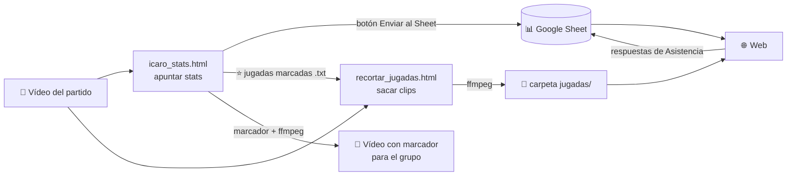

# Icaro Barbarouses · web, estadísticas y vídeo

Documentación de todo lo que compone el proyecto y de cómo poner en marcha cada parte.
Última actualización: 13 de octubre de 2026 (temporada 26/27).

## 1. Qué hay y en qué estado está

| Pieza | Dónde está | Para qué sirve | Estado |
|---|---|---|---|
| Base de datos | Google Sheet [Icaro Barbarouses · Web (base de datos)](https://docs.google.com/spreadsheets/d/1N6oQY-zU6FefQ8Acj9QWua1Vyo71VWBaLkBQwKzky50/edit) | Guarda calendario, jugadores, estadísticas, quintetos y asistencia | Creada y cargada (24/25, 25/26 y calendario 26/27) |
| Script del Sheet | `Code.gs` | Deja que el tracker y la web lean y escriban en el Sheet | Escrito. **Falta instalarlo** (apartado 3.2). Probado solo en simulación |
| Tracker | `icaro_stats.html` | Apuntar estadísticas viendo el vídeo, con marcador, reloj y quintetos | Funciona. El envío al Sheet depende de instalar el script |
| Recortar jugadas | `recortar_jugadas.html` | Marcar jugadas en el vídeo y sacar un clip por jugada | Funciona. Probado con un vídeo corto de prueba |
| Roles automáticos | `roles.js` | Calcula el título de rol de cada jugador según sus stats | Escrito y probado con los datos de 25/26 |
| Diseño de la web | [Web Icaro Barbarouses](https://claude.ai/artifact/8xtoutGp2PD6FJj9qPkiZN) | Maqueta de todas las páginas, con datos reales de la 25/26 | Maqueta. No es la web real |
| Web real | — | Sitio en GitHub Pages que lee el Sheet | **Sin construir** (apartado 7) |

Los vídeos de partido usados en las pruebas eran de 2 minutos. Con un partido real de una hora no se ha probado nada todavía.

## 2. Cómo encaja todo

La idea en una frase: **el Google Sheet es el centro**. Todo lo que se apunta acaba en él, y la web solo lee de él.



(GitHub dibuja este esquema solo al abrir el README. Si se ve como texto, la misma información está aquí abajo.)

Hay cuatro caminos, y cada uno empieza en un sitio distinto:

| Camino | Empieza en | Pasa por | Acaba en | Quién lo hace |
|---|---|---|---|---|
| 1. Estadísticas | Vídeo del partido | `icaro_stats.html` → botón **Enviar al Sheet** | Hojas Partidos, Box y Quintetos del Sheet → la web las muestra | Quien apunta el partido |
| 2. Vídeo con marcador | El mismo tracker, al acabar | Exportar `marcador.ass` → ffmpeg | `partido_marcador.mp4`, para mandarlo al grupo (no va a la web) | Quien apunta el partido |
| 3. Jugadas | El tracker (jugadas marcadas con ⭐, exportadas en un .txt) o el vídeo directamente | `recortar_jugadas.html` → script con ffmpeg | Un .mp4 por jugada en la carpeta `jugadas/` → la web las enseña en la pestaña Jugadas | Quien apunta el partido |
| 4. Asistencia | Cada jugador, desde la web (pestaña Asistencia) | `Code.gs` | Hojas Convocatoria y ConvocatoriaHistorial del Sheet → la web enseña quién va | Cada jugador |

Lo que conviene tener claro:

- **El Sheet solo guarda datos en bruto** (lo que pasó en cada partido). Medias, por 36 minutos, máximos, récords, porcentajes, quintetos y roles los calcula la web cada vez que se abre.
- **`Code.gs` es la puerta del Sheet**: el tracker y la pestaña Asistencia no escriben directamente en el Sheet, le mandan los datos a este script y él los coloca en su hoja.
- **Los partidos completos no van a la web** (pesan demasiado para GitHub Pages): se suben a YouTube como "oculto" y en el Sheet se guarda el enlace. Los clips de jugadas sí van, comprimidos, en una sola carpeta.

## 3. Puesta en marcha (se hace una vez)

### 3.1 Instalar ffmpeg

Hace falta para incrustar el marcador en el vídeo y para recortar jugadas.

- Windows: abre una terminal y ejecuta `winget install ffmpeg`. Cierra y vuelve a abrir la terminal.
- Mac: `brew install ffmpeg` (necesita Homebrew).
- Comprobación: `ffmpeg -version` debe mostrar un número de versión.

### 3.2 Instalar el script en el Sheet

1. Abre el Google Sheet → **Extensiones → Apps Script**.
2. Borra lo que haya y pega el contenido de `Code.gs`. Guarda.
3. **Implementar → Nueva implementación → Tipo: Aplicación web**.
   - Ejecutar como: **Yo**.
   - Quién tiene acceso: **Cualquier usuario**.
4. Autoriza los permisos que pida Google.
5. Copia la URL que termina en `/exec`. Es la que usan el tracker y la web.

Si más adelante cambias `Code.gs`: **Implementar → Gestionar implementaciones → editar → Versión nueva**. Así la URL no cambia.

Comprobación: abre en el navegador la URL seguida de `?action=setup`. Debe devolver un texto que empieza por `{"ok":true`.

No hay PIN. Quien tenga la URL puede enviar respuestas de asistencia y partidos. La URL irá dentro del código de la web, que es pública. Si algo se estropea, el historial de versiones de Google Sheets (Archivo → Historial de versiones) permite deshacerlo.

### 3.3 Conectar el tracker

1. Abre `icaro_stats.html` en el navegador (Chrome o Edge).
2. Pestaña **Setup** → pega la URL `/exec` → **Cargar partidos del Sheet**.
3. La URL queda guardada en ese navegador. No hay que volver a ponerla.

## 4. Qué hacer después de cada partido

1. **Sube el vídeo completo a YouTube** como "oculto" y pega el enlace en la columna `Video` de la hoja Partidos.
2. **Apunta las estadísticas** con `icaro_stats.html` viendo el vídeo (apartado 5.3).
3. **Envía al Sheet** desde la pestaña Enviar. Descarga también el Excel de copia de seguridad.
4. **Opcional, vídeo con marcador:** descarga `marcador.ass` y ejecuta el comando de ffmpeg.
5. **Opcional, jugadas:** marca las jugadas con `recortar_jugadas.html` y genera los clips (apartado 5.4).
6. Cuando exista la web: copia los clips a su carpeta `jugadas`.

## 5. Cada pieza en detalle

### 5.1 Google Sheet

No cambies los nombres de las hojas ni de las columnas de la fila 1: el script y la web los buscan por nombre.

| Hoja | Quién la rellena | Contenido |
|---|---|---|
| LEEME | — | Instrucciones resumidas |
| Ejemplo | — | Un partido real (25/26, J9) tal como queda en Partidos, Box y Quintetos. La web no la lee |
| Temporadas | Tú, una vez al año | `Actual = Sí` marca la temporada que abre la web y el tracker |
| Jugadores | Tú | Nombre, dorsal, posición, fotos, bio. `Activo = Sí` para la plantilla actual |
| Partidos | Tú (calendario) y el tracker (resultado) | Una fila por partido |
| Box | Tracker | Una fila por jugador, partido y cuarto |
| Quintetos | Tracker | Una fila por tramo con los mismos cinco en pista |
| Convocatoria | Web | Última respuesta de cada jugador para cada partido |
| ConvocatoriaHistorial | Web | Todas las respuestas, también las que luego se cambian |
| Media | Tú | Enlaces a fotos y vídeos |
| Clasificacion | Tú, opcional | Tabla de la liga |

Columnas principales:

- **Partidos:** Temporada, ID, Fase, Jornada, Fecha, Hora, Rival, Local, Pista, Estado, PF, PC, Q1F, Q1C … Q4F, Q4C, PRF, PRC, Video, Notas. `Estado` es `Programado` o `Jugado`. El ID tiene la forma `26/27-J01` (playoffs: `26/27-PO01`).
- **Box:** Temporada, PartidoID, Jugador, Cuarto, MIN, PTS, FGM, FGA, 3PM, 3PA, FTM, FTA, REBO, REBD, REB, AST, STL, BLK, TOV, +, -.
  - `Cuarto` va de 1 a 4, y 5 es la prórroga. En las estadísticas por cuarto la web suma la prórroga al 4º; en la página del partido sale aparte. `Cuarto = 0` es partido completo: así están cargadas la 24/25 y la 25/26.
  - `MIN` ya va escalado a 12 minutos por cuarto (apartado 5.3).
  - FGM y FGA incluyen los triples. `+` y `-` son los puntos a favor y en contra con el jugador en pista.
- **Quintetos:** (Cuarto 5 = prórroga) Temporada, PartidoID, Cuarto, Tramo, J1 … J5, MIN, PF, PC, T2M, T2A, T3M, T3A, TLM, TLA. Los jugadores van en orden alfabético. M = metidos, A = intentados; son los tiros del equipo durante ese tramo.
- **Convocatoria:** Temporada, PartidoID, Jugador, Estado, Comentario, Actualizado. `Estado`: 0 No puedo, 1 75% que no, 2 Seguramente pueda, 3 Puedo 100%, 4 Voy al partido.
- **ConvocatoriaHistorial:** Fecha, Temporada, PartidoID, Jugador, Estado, Respuesta, Comentario, EstadoAnterior, RespuestaAnterior.

Nombres unificados entre temporadas: el Nacho de 24/25 y 25/26 figura como **Iggy** (misma persona), Daniel como **Dani** y Manu como **Manute**. El Nacho de la 26/27 es un jugador nuevo.

Plantilla 26/27: Darío 3, Javi 12, Nacho 33, Iggy 45, Álvaro 5, Carlos 13, Fran 4, Miguel 21, Manute 22, Dani 77.

### 5.2 Script del Sheet (`Code.gs`)

| Petición | Qué hace |
|---|---|
| `GET …/exec?action=all` | Devuelve todas las hojas públicas en JSON (la usará la web) |
| `GET …/exec?action=setup` | Devuelve Temporadas, Jugadores, Partidos y Convocatoria (la usa el tracker) |
| `POST` con `action: "convocatoria"` | Guarda la respuesta de un jugador. Sobrescribe su fila en Convocatoria y añade una fila a ConvocatoriaHistorial |
| `POST` con `action: "partido"` | Sustituye las filas de Box y Quintetos de ese partido y actualiza su fila en Partidos |

- El jugador de una respuesta de convocatoria tiene que existir en la hoja Jugadores, escrito igual.
- Enviar dos veces el mismo partido no duplica nada: se reemplaza lo anterior.
- Si la hoja ConvocatoriaHistorial no existe, el script la crea.

### 5.3 Tracker (`icaro_stats.html`)

Se usa después del partido, viendo el vídeo grabado. Todo se guarda solo en el navegador mientras apuntas.

**Preparar el partido (pestaña Setup)**
1. Elige el partido en el desplegable. Rellena rival, fecha, temporada e ID.
2. "Cargar convocados" pone a quienes respondieron "Puedo 100%" o "Voy al partido". Si no hay respuestas, carga la plantilla activa.
3. Pulsa **🎬 Vídeo** y abre el archivo. El vídeo queda a la izquierda y el tracker a la derecha. El vídeo no se sube a ningún sitio.

**Apuntar (pestañas 1er, 2do, 3ro, 4to y Prórroga)**
1. Los cinco en pista se fijan al empezar cada cuarto y con el botón Cambio (ver abajo).
2. Cada acción se apunta en la tarjeta del jugador: 2✓, 2✗, 3✓, 3✗, TL✓, TL✗, rebotes, asistencia, robo, tapón, pérdida.
3. Las canastas propias se apuntan solo en la tarjeta del jugador (2✓, 3✓, TL✓): con eso sube el marcador del vídeo en ese instante, se suma el +/− a los cinco de pista y los puntos al quinteto. Para el rival, botones rojos **+1 / +2 / +3** junto a "Anota el rival". Si se borra una canasta (modo edición o ✕ en la lista bajo el vídeo), se quita de todo a la vez.
4. El lápiz de cada jugador activa el modo edición para restar o corregir.

**Reloj y cuartos (bajo el vídeo)**
- Elige el cuarto y pulsa **Inicio de cuarto** en el momento exacto en que empieza. El vídeo se para y aparece el quinteto inicial propuesto (los cinco que acabaron el cuarto anterior). Hay que revisarlo y confirmarlo (tienen que ser 5) para que arranque.
- **Fin de cuarto** cuando acaba. Al acabar el 4º pregunta si hay prórroga: "Fin del partido" o "Hay prórroga" (aparece la pestaña Prórroga, 3 minutos por defecto).
- **🔁 Cambio:** cuando se para el juego para hacer cambios. El reloj se para; en "En pista" quitas a los que salen y marcas a los que entran, y pulsas **Confirmar cambios** cuando se vuelve a jugar. El quinteto nuevo cuenta desde ahí.
- **⏩ Descanso / parón:** para descansos entre cuartos, lesiones o parones. El vídeo avanza a 4× sin sonido (y, si es dentro de un cuarto, el reloj se para). Cuando ves que se vuelve a jugar, pulsa **Ya se juega**: el vídeo se para y retrocede 10 s para que marques el momento exacto con Inicio de cuarto o Reanudar reloj.
- El reloj corre al ritmo real del vídeo desde lo que marque al empezar (12:00 por defecto). Si un cuarto empieza con menos tiempo, cambia "reloj al empezar" para ese cuarto. Si el cuarto acaba antes de llegar a 0:00, el reloj se queda donde esté al marcar el fin.
- **TM Icaro / TM rival:** tiempo muerto. Para el reloj del partido y muestra su propia cuenta atrás (90 s por defecto, campo "TM (s)"). Si se reanuda antes, pulsa "Acabar TM".
- **Parar reloj / Reanudar reloj** para otros parones largos.
- **Parcial:** cuando un equipo mete 5 puntos seguidos aparece bajo el marcador (por ejemplo "Parcial 7-0 Icaro Barbarouses"). Desaparece al acabar el cuarto, tras 3 minutos de juego sin cambiar, o cuando el otro equipo deja la diferencia del parcial por debajo de 5 (7-0 y triple rival: 7-3, desaparece).
- **Nombres en el marcador:** "Icaro Barbarouses" y el rival tal como está escrito en el Sheet (campo Rival del partido).
- **Posición del marcador:** la cuadrícula "marcador" (6 casillas: arriba o abajo, izquierda, centro o derecha) lo coloca ahí desde el momento del vídeo en que estés. Se puede cambiar las veces que quieras durante el partido; cada cambio sale en la lista bajo el vídeo y se borra con ✕. El vídeo final respeta esos cambios.
- Adelantar, atrasar o cambiar la velocidad no descuadra nada: todo va ligado al segundo del vídeo, así que el reloj, el tiempo muerto y el marcador se mueven con él.
- La lista bajo el vídeo muestra todo lo marcado. Al borrar una anotación de puntos se quita también del +/− y del quinteto.

**Minutos (automáticos)**
- Cada tramo de quinteto suma el tiempo real de juego desde su entrada hasta el siguiente cambio, sin contar tiempos muertos, cambios ni parones. Cada jugador suma los tramos en los que está.
- Al marcar el fin de cuarto, todos los minutos de ese cuarto se multiplican por 12 / duración real. Ejemplo: un cuarto de 10 minutos reales tiene factor 1,2; quien jugó 5 minutos reales queda con 6. La prórroga se escala a sus minutos (3).
- Así cada cuarto suma siempre 12 minutos por puesto. Ya no hay botón +min; si hace falta corregir, se puede editar en la tarjeta del jugador (lápiz) o en la pestaña Quintetos.

**Quintetos (pestaña Quintetos)**
- Muestra cada tramo con minutos, puntos a favor y en contra, y los tiros de 2, triples y libres del equipo en ese tramo.
- Los tiros solo cuentan para un quinteto si hay cinco jugadores marcados en pista al apuntarlos.
- Avisa si los minutos de un cuarto no suman 12 o si los puntos de los tramos no coinciden con el marcador.

**Jugadas para recortar luego**
- Mientras apuntas, pulsa **⭐ Jugada** (tecla J) cuando veas una jugada que merezca clip. Se guarda el momento del vídeo con su cuarto, reloj y marcador.
- Salen en la lista bajo el vídeo; con ✕ se quitan.
- Al acabar: **⬇ Jugadas marcadas (.txt)** descarga la lista para la herramienta de recortar jugadas (apartado 5.4).

**Enviar (pestaña Enviar)**
- **Enviar al Sheet** escribe Box, Quintetos y el resultado.
- **Descargar Excel** es una copia de seguridad.

**Vídeo con marcador**

Debajo del vídeo hay dos casillas con las carpetas. Vienen rellenas y el navegador las recuerda:
- **Carpeta del vídeo:** `C:\Users\carlo\Desktop\Basket_Icaro\SEASON 26-27`
- **Carpeta del .ass:** `C:\Users\carlo\Downloads` (en Windows en español se ve como "Descargas", pero la ruta real es `Downloads`).

1. **Descargar marcador (.ass)**: se guarda en Descargas.
2. **Incrustar marcador (.bat)** y doble clic en el archivo descargado. Comprueba que existen el vídeo y el marcador, y si falta alguno dice cuál.
   - O, si prefieres la terminal: **Copiar comando ffmpeg** y pegarlo en cualquier terminal (cmd o PowerShell, da igual en qué carpeta esté). Lleva las rutas completas:
   ```
   ffmpeg -i "C:\Users\carlo\Desktop\Basket_Icaro\SEASON 26-27\Jornada 09 - HOEMIES vs ICARO.mp4" -vf "ass='C\:/Users/carlo/Downloads/marcador.ass'" -c:a copy "C:\Users\carlo\Desktop\Basket_Icaro\SEASON 26-27\Jornada 09 - HOEMIES vs ICARO_marcador.mp4"
   ```
   La ruta del .ass va con barras `/` y `C\:` a propósito: es como ffmpeg la entiende dentro de `-vf`.
3. Sale `..._marcador.mp4` en la carpeta del vídeo, con marcador, cuarto, reloj, tiempos muertos y parciales. Recodifica el vídeo entero, así que tarda.

Si el navegador guarda el marcador como `marcador (1).ass` (porque ya había uno), borra los antiguos de Descargas y vuelve a descargarlo.

**Controles del vídeo:** botones « 10 s, « 5 s, 5 s », 10 s », ×1 y ×1,5. Atajos: Espacio pausa · ← → saltan 5 s · , y . cambian la velocidad.

### 5.4 Recortar jugadas (`recortar_jugadas.html`)

1. **Abrir vídeo.**
2. Pulsa **Marcar jugada** (tecla J) justo después de la jugada. El vídeo se para y sale un panel.
3. En el panel, todo con botones:
   - Jornada (solo la primera vez en cada vídeo; la temporada es siempre 26/27).
   - Jugador o jugadores. "Equipo" si no es de nadie en concreto.
   - Palabras clave: jugada, bandeja, triple, media distancia, and 1, asistencia, tapón, robo, rebote, bocina, fail.
   - Descripción, opcional.
4. **Guardar y seguir** (Enter) o **Descartar** (Esc). El vídeo continúa.
5. Al terminar: **Recortar en Windows (.bat)** o **Recortar en Mac/Linux (.sh)**.
6. Pon el archivo descargado en la carpeta del vídeo y ábrelo (Mac: `sh recortar_jugadas.sh` en la terminal). Crea la carpeta `jugadas` con un vídeo por jugada.

Desde la lista del tracker:
- **Cargar lista (.txt)** con el archivo de jugadas marcadas del tracker. Si el partido viene en el archivo, la jornada se marca sola.
- ▶ (o "Siguiente" / tecla N) lleva el vídeo a cada momento marcado, unos segundos antes.
- **✂ Crear clip** abre el panel de jugadores y palabras clave con la jugada ya situada en ese momento. Las hechas quedan con ✓.
- Se puede seguir marcando jugadas a mano con "Marcar jugada", aunque no estén en la lista.

Detalles:
- Por defecto guarda 8 segundos antes y 2 después de pulsar. Se cambia junto al botón.
- Cualquier jugada de la lista se puede abrir para corregir tiempos, jugadores o palabras clave.
- "Otra palabra clave…" añade una palabra nueva como botón. Queda guardada en el navegador.
- Los filtros por palabra clave y por jugador sirven para revisar; "Ver las que salen seguidas" las reproduce una tras otra.
- Opciones al recortar: preparar para la web (720p y poco peso, activado por defecto), recortar del vídeo que ya tiene el marcador, y recortar solo las jugadas del filtro actual.
- "Guardar lista de jugadas" descarga un archivo con todo lo marcado, por si cambias de navegador u ordenador.

**Nombre de los clips.** Toda la información va en el nombre del archivo:

```
2627-J03__Carlos_Dario__triple_bocina__triple-desde-la-esquina__02.mp4
   │           │              │                   │              │
 temporada   jugadores    palabras clave      descripción      número
 y jornada
```

- Los campos se separan con dos guiones bajos. Dentro de un campo, los jugadores y las palabras clave se separan con uno.
- Sin tildes ni símbolos: `Álvaro` pasa a `Alvaro`, `tapón` a `tapon`.
- La web leerá ese nombre para colocar cada clip en la ficha de sus jugadores y para los filtros por palabra clave y jornada. No hay que rellenar nada más.

### 5.5 Diseño de la web

Maqueta en el artefacto de diseño, con datos reales de la 25/26 salvo donde se indica.

| Página | Contenido |
|---|---|
| Inicio | Balance, último y próximo partido, líderes, puntos por cuarto |
| Calendario | 26/27 (20 partidos y 2 descansos) y resultados de la 25/26 |
| Partido | Marcador, parciales y box score por cuarto |
| Plantilla | Los diez de la 26/27 |
| Jugador | Ficha, medias, por 36, tiro, máximos, partido a partido y sus jugadas |
| Estadísticas | Cuatro vistas: Medias, Por 36 min, Tiro y avanzadas, Máximos |
| Gráficas | Evolución por jugador, eligiendo quién sale |
| Quintetos | Minutos, marcador, +/− y acierto de tiro por quinteto |
| Récords | Un partido, una temporada, carrera y equipo |
| Jugadas | Todos los clips, con filtros por jugador, palabra clave y jornada |
| Asistencia | Formulario de convocatoria y quién jugó cada jornada |
| Histórico | Comparador de dos temporadas a elegir |

Datos de ejemplo, no reales: las jugadas (páginas Jugador y Jugadas), las respuestas y horas de Asistencia.
En el lienzo, Estadísticas y Récords aparecen repetidas una vez por cada vista; en la web real cada una es una sola página con selector.

### 5.6 Roles automáticos (`roles.js`)

El título de rol que sale en la ficha de cada jugador ("Alero anotador de tres niveles", "Tiburón del rebote ofensivo"…; no aparece en la lista de la plantilla) no se escribe a mano: la web lo calcula cada vez que carga los datos, así que cambia solo cuando cambian las estadísticas.

Cómo se elige:

1. Se cogen las estadísticas de la temporada (totales de Box) y se pasan a **por 36 minutos**. Solo cuentan los jugadores con **5 partidos o más**.
2. Cada jugador se compara con el resto del equipo: puesto en puntos, rebotes, rebotes ofensivos, asistencias, robos, tapones, +/-, valoración y minutos, más su perfil de tiro (qué parte de sus tiros son triples, cuántos tiros libres saca por tiro, porcentajes).
3. Solo se miran los roles de **sus posiciones** (columna Posición de Jugadores). Si tiene dos, se miran ambas; la primera que aparece tiene un pequeño desempate a favor.
4. De todos los roles que cumple, se queda el de **mayor prioridad**. Los demás que cumple salen como rasgos secundarios ("También: Reboteador, Intimidador").
5. Un mismo título no se repite en el equipo (salvo los "de rotación"): si dos lo cumplen, se lo lleva el de mayor prioridad y el otro pasa a su siguiente rol.
6. Cada rol enseña un "por qué" con los números reales ("Líder en rebotes ofensivos (2,7/36)").

Casos especiales:

- Menos de 5 partidos en la temporada actual: se muestra el rol de la última temporada en la que tuvo 5, marcado "según 25/26".
- Jugador nuevo sin partidos: "Por descubrir".
- Columna **Arquetipo** de Jugadores: si tiene texto, ese texto sustituye al rol automático. Vacía = automático.
- En la ficha del jugador se ve cómo ha ido cambiando el rol a lo largo de la temporada (tras la jornada 5, 10, 15…).

Para cambiar umbrales, nombres o añadir roles: editar el array `C` de `roles.js`. Cada entrada tiene posición, título, rasgo corto, prioridad, condición y texto del "por qué".

Roles con los datos de la 25/26: Carlos, Alero anotador de tres niveles · Álvaro, Pívot dominante · Miguel, Tiburón del rebote ofensivo · Darío, Ala-pívot anotador · Javi, Escolta ladrón de balones · Iggy, Escolta sin errores · Fran, Pívot sacrificado · Manute (24/25), Base anotador · Dani (24/25), Escolta de rotación · Nacho, Por descubrir.

Catálogo completo (68 roles):

**Base**

| Rol | Rasgo | Prioridad | Cuándo (por 36 min, comparado con el equipo) |
|---|---|---|---|
| Base total | Todoterreno | 95 | top 2 en puntos · top 2 en asistencias · top 3 en rebotes |
| Base estrella | Referente | 86 | 1º en puntos · top 3 en asistencias |
| Base creador de tiros | Creador | 82 | top 2 en asistencias · top 3 en puntos |
| Base director de juego | Organizador | 80 | 1º en asistencias · ≥1 ast por pérdida |
| Base anotador | Anotador | 75 | top 2 en puntos |
| Base penetrador | Penetrador | 68 | ≥3,5 libres por cada 10 tiros · top 4 en puntos |
| Base tirador | Tirador | 66 | 45%+ de sus tiros son triples · triples intentados ≥ 3 |
| Base de presión | Ladrón | 64 | top 2 en robos · robos ≥ 1 |
| Base reboteador | Reboteador | 62 | top 3 en rebotes |
| Base seguro con el balón | Sin pérdidas | 58 | pérdidas ≤ 1,5 · ≥1,2 ast por pérdida |
| Base con gatillo fácil | Gatillo fácil | 55 | top 2 en tiros intentados · % de campo por debajo del equipo |
| Base pasador | Pasador | 52 | top 3 en asistencias |
| Base de rotación | — | 1 | Si no encaja en ningún otro |

**Escolta**

| Rol | Rasgo | Prioridad | Cuándo (por 36 min, comparado con el equipo) |
|---|---|---|---|
| Escolta estrella | Referente | 90 | 1º en puntos · ≥25% de los puntos del equipo |
| Escolta 3&D | 3&D | 78 | 35%+ de sus tiros son triples · triples intentados ≥ 1,5 · top 2 en robos |
| Escolta anotador | Anotador | 75 | top 2 en puntos |
| Francotirador | Tirador | 74 | ≥33% en triples · triples intentados ≥ 3 |
| Microondas desde el banquillo | Microondas | 70 | top 3 en puntos · minutos por partido < mediana |
| Escolta ladrón de balones | Ladrón | 68 | top 2 en robos · robos ≥ 1 |
| Escolta penetrador | Penetrador | 66 | ≥3,5 libres por cada 10 tiros · tiros intentados ≥ 4 |
| Escolta tirador | Tirador | 64 | 40%+ de sus tiros son triples · triples intentados ≥ 2 |
| Escolta segundo creador | Creador | 62 | top 3 en asistencias |
| Escolta reboteador | Reboteador | 60 | top 4 en rebotes |
| Escolta sin errores | Sin pérdidas | 56 | pérdidas ≤ 1 · minutos por partido ≥ 10 |
| Escolta de energía | Energía | 50 | robos+rebotes ≥ mediana del equipo · tiros intentados ≤ mediana |
| Escolta de rotación | — | 1 | Si no encaja en ningún otro |

**Alero**

| Rol | Rasgo | Prioridad | Cuándo (por 36 min, comparado con el equipo) |
|---|---|---|---|
| Alero anotador de tres niveles | Tres niveles | 92 | 1º en puntos · 25%+ de sus tiros son triples · ≥2,5 libres por cada 10 tiros |
| Alero navaja suiza | Todoterreno | 88 | top 3 en al menos 4 de: puntos, rebotes, asistencias, robos, tapones |
| Alero anotador | Anotador | 75 | top 2 en puntos |
| Point forward | Organizador | 72 | top 2 en asistencias |
| Alero que ataca el aro | Penetrador | 70 | ≥3,5 libres por cada 10 tiros · top 4 en puntos |
| Alero 3&D | 3&D | 68 | 30%+ de sus tiros son triples · triples intentados ≥ 1,5 · top 3 en robos |
| Alero reboteador | Reboteador | 66 | top 3 en rebotes |
| Alero tirador | Tirador | 62 | 40%+ de sus tiros son triples · triples intentados ≥ 2 |
| Alero defensor | Defensor | 60 | top 3 en robos o (top 2 en tapones · tapones ≥ 0,5) |
| Alero pegamento | Pegamento | 55 | tiros intentados ≤ mediana · reb+rob+ast ≥ mediana |
| Alero sin errores | Sin pérdidas | 50 | pérdidas ≤ 1 · minutos por partido ≥ 10 |
| Alero de rotación | — | 1 | Si no encaja en ningún otro |

**Ala-pívot**

| Rol | Rasgo | Prioridad | Cuándo (por 36 min, comparado con el equipo) |
|---|---|---|---|
| Doble-doble andante | Doble-doble | 90 | puntos ≥ 10 · rebotes ≥ 10 |
| Ala-pívot dueño del rebote | Reboteador | 85 | 1º en rebotes |
| Ala-pívot abierto | Tirador | 75 | 30%+ de sus tiros son triples · triples intentados ≥ 2 |
| Ala-pívot anotador | Anotador | 74 | top 3 en puntos |
| Ala-pívot de poste bajo | Poste bajo | 70 | 15% o menos de sus tiros son triples · top 4 en puntos · tiros intentados ≥ 5 |
| Ala-pívot de segundas oportunidades | Rebote ofensivo | 68 | top 2 en reb. ofensivos |
| Ala-pívot reboteador | Reboteador | 66 | top 3 en rebotes |
| Ala-pívot intimidador | Intimidador | 64 | top 2 en tapones · tapones ≥ 0,5 |
| Ala-pívot pasador | Pasador | 62 | top 3 en asistencias |
| Ala-pívot de manos rápidas | Ladrón | 60 | top 3 en robos · robos ≥ 0,7 |
| Ala-pívot que busca el contacto | Penetrador | 58 | ≥3,5 libres por cada 10 tiros · tiros intentados ≥ 3 |
| Ala-pívot currante | Currante | 50 | rebotes ≥ mediana · tiros intentados ≤ mediana |
| Ala-pívot de rotación | — | 1 | Si no encaja en ningún otro |

**Pívot**

| Rol | Rasgo | Prioridad | Cuándo (por 36 min, comparado con el equipo) |
|---|---|---|---|
| Pívot dominante | Referente | 92 | top 2 en puntos · top 2 en rebotes |
| Ancla defensiva | Intimidador | 85 | 1º en tapones · tapones ≥ 1 · top 3 en rebotes |
| Pívot dueño del rebote | Reboteador | 84 | 1º en rebotes |
| Tiburón del rebote ofensivo | Rebote ofensivo | 80 | 1º en reb. ofensivos |
| Protector del aro | Intimidador | 78 | 1º en tapones · tapones ≥ 0,8 |
| Pívot anotador | Anotador | 74 | top 3 en puntos |
| Pívot abierto | Tirador | 70 | 25%+ de sus tiros son triples · triples intentados ≥ 1,5 |
| Pívot reboteador | Reboteador | 66 | top 3 en rebotes |
| Pívot pasador | Pasador | 62 | top 3 en asistencias |
| Pívot de segundas oportunidades | Rebote ofensivo | 60 | top 3 en reb. ofensivos |
| Obrero de la pintura | Currante | 55 | rebotes ≥ mediana · tiros intentados ≤ 3 |
| Pívot sacrificado | Sacrificio | 45 | tiros intentados ≤ 3 |
| Pívot de rotación | — | 1 | Si no encaja en ningún otro |

**Cualquier posición**

| Rol | Rasgo | Prioridad | Cuándo (por 36 min, comparado con el equipo) |
|---|---|---|---|
| Jugador franquicia | Franquicia | 60 | ≥33% de los puntos del equipo · 1º en valoración · 1º en puntos |
| El más eficiente | Eficiente | 48 | 1º en % tiro real · tiros intentados ≥ 4 |
| Mr. Más/Menos | +/- | 46 | 1º en +/- · +/- positivo |
| Hombre de hierro | Hierro | 40 | 1º en minutos por partido |

## 6. Fórmulas

- **Puntos:** 2 × tiros de 2 metidos + 3 × triples metidos + tiros libres metidos.
- **Eficiencia (EFF):** PTS + REB + AST + ROB + TAP − tiros de campo fallados − tiros libres fallados − pérdidas.
- **Valoración (VAL):** PTS + 1,2 × REB + 1,5 × AST + 2 × (ROB + TAP) − 1,5 × PÉR.
- **eFG%:** (tiros de campo metidos + 0,5 × triples metidos) / tiros de campo intentados.
- **TS%:** PTS / (2 × (tiros de campo intentados + 0,44 × tiros libres intentados)).
- **Por 36 minutos:** valor × 36 / minutos jugados.
- **+/− por 36 de un quinteto:** (puntos a favor − puntos en contra) × 36 / minutos del quinteto.

## 7. Lo que falta por hacer

1. **Instalar `Code.gs`** y probar un envío real desde el tracker y una respuesta de asistencia.
2. **Probar con un partido real de una hora:** apuntado completo, marcador incrustado y recorte de jugadas.
3. **Construir la web real** para GitHub Pages a partir del diseño:
   - Leer el Sheet con `…/exec?action=all`.
   - Enviar la asistencia con `action: "convocatoria"`.
   - Leer la carpeta `jugadas` del repositorio y repartir los clips según su nombre.
   - Alojar también el tracker y la herramienta de jugadas en el mismo repositorio.
4. **Rellenar a mano en el Sheet:** fotos y bio de Jugadores, enlaces de vídeo de cada partido.

## 8. Problemas frecuentes

| Qué pasa | Causa probable | Qué hacer |
|---|---|---|
| "No se pudo leer el Sheet" en el tracker | URL mal copiada, o el script no está desplegado con acceso "Cualquier usuario" | Revisa el apartado 3.2 y prueba la URL con `?action=setup` |
| "Jugador desconocido" al responder la asistencia | El nombre no coincide con la hoja Jugadores | Escríbelo igual, con tildes |
| Cambié `Code.gs` y no se nota | Falta publicar una versión nueva | Implementar → Gestionar implementaciones → editar → Versión nueva |
| El navegador no reproduce el vídeo | Formato no admitido (algunos .mov de iPhone en HEVC) | Prueba otro navegador o conviértelo: `ffmpeg -i entrada.mov -c:v libx264 -c:a aac salida.mp4` |
| `ffmpeg` no se reconoce | No está instalado o la terminal estaba abierta al instalarlo | Apartado 3.1; abre una terminal nueva |
| `Error opening input: No such file or directory` con el comando del marcador | El comando antiguo usaba solo el nombre del vídeo y la terminal estaba en otra carpeta | Usa el .bat o el comando nuevo, que llevan la ruta completa. Revisa que la casilla Carpeta del vídeo sea la correcta |
| No encuentra `marcador.ass` | Se descargó con otro nombre (`marcador (1).ass`) o en otra carpeta | Borra los antiguos y vuelve a descargarlo, o corrige la casilla Carpeta del .ass |
| Aviso "el marcador del vídeo no coincide con el del partido" | Alguna canasta se apuntó sin el vídeo abierto o se corrigió a mano con los campos de edición | Revisa la lista bajo el vídeo |
| El reloj del marcador va desajustado | El reloj real se paró y no se marcó, o el cuarto empezó con otro tiempo | Usa TM o Parar reloj en esos parones y ajusta "reloj al empezar" |
| Un quinteto sale sin tiros | Se apuntaron con menos de cinco en pista | Marca los cinco antes de apuntar |
| Se han perdido las anotaciones | Se guardan por navegador; se abrió en otro o se borraron los datos del sitio | Usa siempre el mismo navegador; descarga el Excel o la lista de jugadas como copia |
